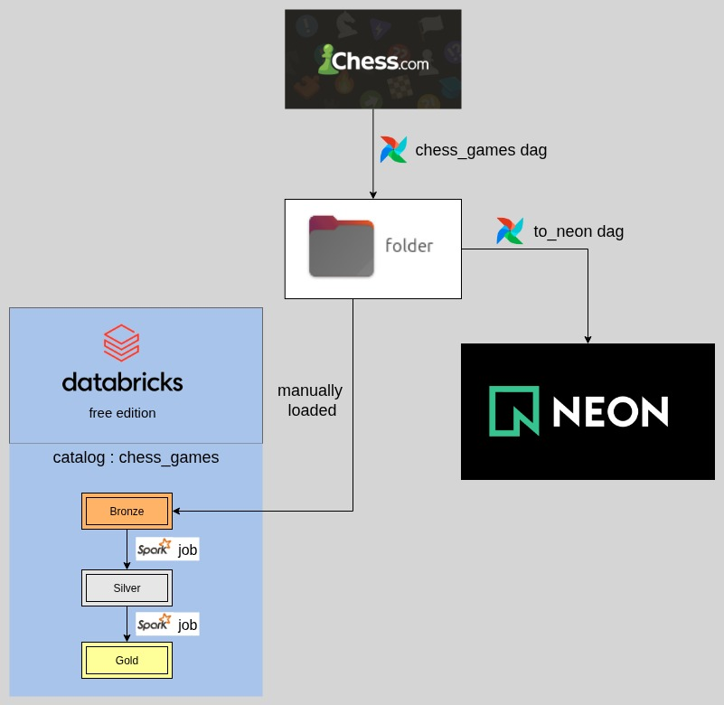

# Chess games data project

An ELT project on my own Chess.com games, built to showcase data engineering skills with free tools:
Apache Airflow, Databricks Community Edition (working around its limits) and dbt.
The goal is not an optimized, production-grade pipeline. It is to show clear code, sound architecture choices and practical problem solving.
The same transformations are implemented twice, in Databricks (Spark) and in dbt (PostgreSQL), to show versatility across stacks.

# How it works
1. Games are extracted from the Chess.com API.
2. The extracted games are saved to a local folder, imported manually into Databricks Community Edition (no API access on the free tier).
3. The `to_neon` Airflow DAG loads the games from the local folder into a Neon (PostgreSQL) database.
4. Databricks transformation (Spark): bronze -> silver -> gold.
4b. dbt transformation (PostgreSQL): the same bronze -> silver -> gold models.

# Roadmap
- BI layer on top of the gold tables (not started).

# Documentation per technology

- [Airflow](./airflow/Airflow_README.md)
- [Chess.com API](./chess.com_API/chess.com_API_README.md)
- [Neon database](./neon_db/neon_db_REAMDE.md)
- [Databricks](./databricks/databricks_README.md)
- [dbt](./dbt/models/dbt_README.md)
